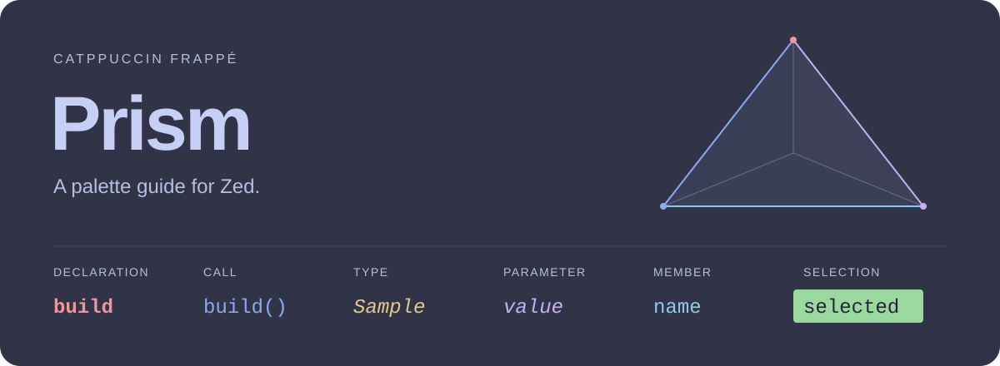
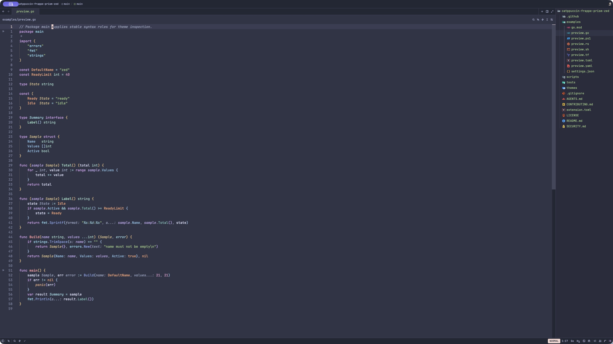

# Catppuccin Frappé Prism

A warm, expressive dark theme for [Zed](https://zed.dev). Frappé's soft surfaces,
with clearer syntax roles, deliberate bold and italic accents, and vivid green
selections.



<details>
<summary>Native Go preview in Zed</summary>



*Zed 1.24.2 with gopls and the optional semantic settings below. Language providers
determine which roles are available. The banner above is an authored palette
guide; this is the unedited native capture.*

</details>

## Install

This theme is available from source. It is **not yet listed in Zed's extension
catalogue**. Zed is the only prerequisite for using the theme.
The commands below install **v0.2.0**. See [CHANGELOG.md](CHANGELOG.md) for its changes.

<details open>
<summary>macOS or Linux</summary>

Run this in any terminal directory:

```sh
(
  set -eu
  theme_dir="$HOME/.config/zed/themes"
  mkdir -p "$theme_dir"
  theme_tmp=$(mktemp "$theme_dir/.frappe-prism.XXXXXX")
  trap '[ ! -f "$theme_tmp" ] || rm "$theme_tmp"' EXIT HUP INT TERM
  curl --fail --location \
    https://raw.githubusercontent.com/Excoriate/catppuccin-frappe-prism-zed/v0.2.0/themes/catppuccin-frappe-prism.json \
    --output "$theme_tmp"
  mv "$theme_tmp" "$theme_dir/catppuccin-frappe-prism.json"
)
```

If you use a custom Zed configuration directory, put the JSON in its `themes/`
directory instead.

</details>

<details>
<summary>Windows · PowerShell</summary>

```powershell
$themeDir = Join-Path $env:APPDATA 'Zed\themes'
New-Item -ItemType Directory -Path $themeDir -Force -ErrorAction Stop | Out-Null
$themeTmp = Join-Path $themeDir ([IO.Path]::GetRandomFileName())
try {
    Invoke-WebRequest -ErrorAction Stop `
      -Uri 'https://raw.githubusercontent.com/Excoriate/catppuccin-frappe-prism-zed/v0.2.0/themes/catppuccin-frappe-prism.json' `
      -OutFile $themeTmp
    Move-Item -LiteralPath $themeTmp `
      -Destination (Join-Path $themeDir 'catppuccin-frappe-prism.json') -Force -ErrorAction Stop
} finally {
    if (Test-Path -LiteralPath $themeTmp) { Remove-Item -LiteralPath $themeTmp }
}
```

</details>

In Zed, open the command palette (`Cmd+Shift+P` on macOS; `Ctrl+Shift+P` on
Linux/Windows), run **theme selector: toggle**, and choose **Catppuccin Frappé
Prism**. If it does not appear, restart Zed once and check that the downloaded
file ends in `.json` inside the `themes` directory. To update, use the download
command from the newer release's README. It replaces only that theme file.

Prefer a checkout? [Download the v0.2.0 ZIP](https://github.com/Excoriate/catppuccin-frappe-prism-zed/archive/refs/tags/v0.2.0.zip)
and extract it, or, with Git installed, run:

```sh
git clone --branch v0.2.0 https://github.com/Excoriate/catppuccin-frappe-prism-zed.git
```

Run **zed: install dev extension** in Zed's command palette and select the extracted
or cloned directory containing `extension.toml`. Then select the theme as above.
This theme-only extension has no Rust compilation step or language-server
installation. Use one installation route at a time; remove a manual JSON copy
before switching to the dev extension to avoid two sources with the same name.

## Color with a purpose

Prism distinguishes roles through color and typography wherever Zed's parser or
language server identifies them.

| Role | Treatment |
| --- | --- |
| Function declarations / calls | Bold coral / blue |
| Method declarations / calls | Bold mint / teal |
| Variables / parameters / fields | Neutral / italic lavender / sky |
| Types / interfaces | Italic cream / cyan |
| Keywords / operators | Mauve and rose / cyan |
| Strings / numbers / booleans | Green / orchid / bold rose |
| Configuration keys / sections / array tables | Blue / bold coral / bold italic gold |
| Comments | Muted blue-gray, italic |
| Selection / symbol occurrences | Bright green / pale lavender |

The theme supplies 138 syntax styles. A style is used only when a language
provider emits its matching capture or a semantic rule maps to it. The included
checker protects role distinctions and a minimum 4.5:1 syntax-foreground contrast
against the editor and active-line backgrounds; it does not prove every language
emits every role.

Configuration-key and section distinctions require matching captures. Stock YAML
and TOML providers may expose fewer distinctions; custom queries are not bundled.

## Retro terminal

Prism's integrated terminal palette uses deep navy (`#080c14`) with phosphor green
text (`#39ff88`). Normal, bright and dim ANSI colors add blue, cyan, magenta, red
and gold accents, with lighter black entries for the dark background.

The palette takes inspiration from
[Neon Blue Split Contrast](https://ghostty-style.vercel.app/config/neon-blue-split-contrast)
and adapts its colors to Zed. Select Prism and open Zed's terminal; no extra
terminal extension or shell profile is required.

## Optional: richer semantic colors and occurrences

Open **zed: open settings file** from Zed's command palette and save a backup of
your current settings. Merge the keys in
[`examples/settings.json`](examples/settings.json) into your existing settings
object. Do not replace your whole settings file. The example contains only:

- Theme selection and combined parser/semantic highlighting.
- Semantic mappings for declarations, calls, parameters, fields, types and constants,
  plus semantic-token support enabled in Go’s gopls.
- Zed's highlight contrast setting of `75`, for text on green selections and
  lavender occurrences.
- `selection_highlight: false`, which disables textual lookalikes while retaining
  language-server symbol occurrences.

If you already have `lsp.gopls.initialization_options`, keep its other values and
merge `semanticTokens: true`. If you already have `global_lsp_settings`, merge its
`semantic_token_rules` array.
Zed uses the first matching rule: keep specific rules before broad rules, and
resolve overlapping rules deliberately instead of duplicating catchalls.

With a supporting language server, place the caret in a variable or select its
whole name. Reads and writes of that symbol in the current document share a
pale lavender background (`#babbf1`). The active selection stays green (`#9ad99e`).
Shadowed variables, comments and strings are not textual matches. Language-server
support is required; this is not a project-wide reference search. Use **Find All
References** for that workflow.

The theme and optional settings do not create missing semantic information.
For example, a server may report a constructor call as an ordinary type, or may
not distinguish parameter uses from local variables. Bash, PowerShell, YAML,
TOML, Terraform and HCL can also differ by grammar and extension version.
Additional language-query refinements used in the author's dotfiles are separate
from this extension. The configuration-key styles in the table require matching
captures; stock YAML or TOML providers may expose fewer distinctions. The optional
settings file supplies semantic mappings, not those custom grammar queries.

To remove Prism, first select another theme. Delete only the downloaded
`catppuccin-frappe-prism.json`, or uninstall the dev extension from Zed's
Extensions page if you used that route. Restore the settings keys and rules you
changed from your backup; keep unrelated preferences and pre-existing rules.

## Contribute

Python 3.11 or newer is needed only for development. From a checkout:

```sh
python3 scripts/check.py
```

There are no packages to install. This is also the CI command. Open the files in
[`examples/`](examples/) in Zed to inspect a change; compare the theme alone and
any semantic settings you used. See [CONTRIBUTING.md](CONTRIBUTING.md) for the
complete review and catalogue submission workflow.

When reporting a flat or incorrect color, include the language, Zed version,
language extension/server, a small sample, and whether you applied the optional
settings. That makes the report actionable without guessing your setup.

## Credits and license

Created by [Alex Torres Ruiz](https://github.com/Excoriate), based on
[Catppuccin](https://github.com/catppuccin/catppuccin) Frappé. This is an independent
variant and is not an official Catppuccin project.

[MIT](LICENSE). The original Catppuccin copyright and MIT permission notice are
retained in [`themes/LICENSE.catppuccin`](themes/LICENSE.catppuccin) and embedded
in the theme JSON so they remain in installed copies.
[Report a security issue privately](SECURITY.md).
